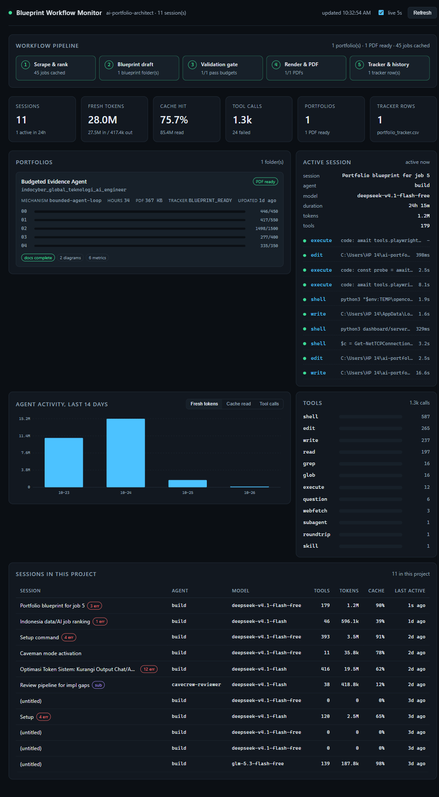

# Workflow Monitor

Local dashboard for **this repository only**. Two data sources:

| Source | What it shows |
|---|---|
| `~/.local/share/opencode/opencode.db` (read-only) | Agent sessions whose working directory is this repo: tokens, cache, tools, timeline |
| `portfolios/`, `job_scraper/`, `portfolio_tracker.csv` | Blueprint pipeline state: word budgets, diagrams, metrics, PDF, tracker row |

Sessions from other projects are filtered out by directory. Nothing is written to the database.

## Run

```
python dashboard/server.py
```

Opens `http://127.0.0.1:8770/`. Stdlib only, no install step.



Options:

```
python dashboard/server.py --no-open        # do not launch the browser
set DASHBOARD_PORT=9000 && python dashboard/server.py
set OPENCODE_DB=C:\path\to\opencode.db && python dashboard/server.py
```

## Panels

- **Workflow pipeline** - scrape, draft, gate, render, track. State is derived from files on disk, not from claims.
- **Stats** - sessions, fresh tokens, cache hit rate, tool calls, portfolio count, tracker rows.
- **Portfolios** - per-folder word budget bars (green under, amber near, red over), missing docs, diagram count, metric row count, PDF size, mechanism and hours from `portfolios/_history.json`.
- **Active session** - newest session in this repo with its last 10 tool calls.
- **Activity chart** - 14-day bars, switchable between fresh tokens, cache read, and tool calls.
- **Tools** - call counts with p50/p95 duration in the tooltip.
- **Sessions** - every session in this repo; click a row for the full token, cache, and tool timeline.

Auto-refresh runs every 5 seconds. Toggle it off for a frozen view.

## API

| Endpoint | Purpose |
|---|---|
| `/api/workflow` | Pipeline stages, portfolio gate state, tracker rows |
| `/api/overview` | Token, cache, and tool aggregates for this repo |
| `/api/sessions` | Session list, newest first |
| `/api/session?id=<ses_id>` | One session with its tool timeline |
| `/api/health` | Database path and reachability |

`?all=1` on the overview and session endpoints drops the directory filter. The UI never sends it.

## Notes

- The database is opened with `mode=ro`, so the monitor cannot corrupt session state.
- Word counts come from the same numbers `tools/check_portfolio.py` enforces, so a red bar means the gate would fail.
- A portfolio shows `PDF ready` only when `Blueprint_Final.pdf` exists on disk.
